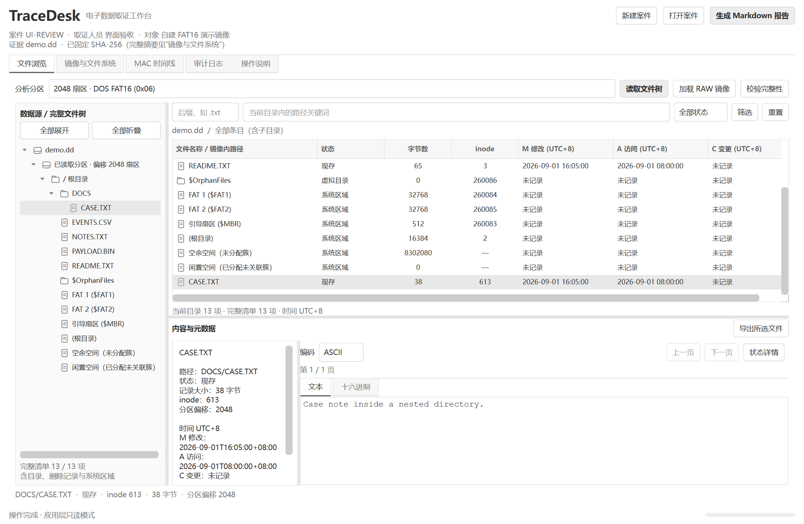

# 白灰文件树工作台：实施与验证

用户确认的设计已接入 PySide6 桌面应用，启动方式保持为项目根目录的 `启动取证工作台.bat`。

## 界面

- 白色主体、浅灰导航与选中项、深灰文字和图标，标题栏与任务栏图标也同步为灰阶。
- 左侧显示镜像、本次读取分区、完整目录层级及文件；删除记录和系统区域保留，不因后缀、路径或状态筛选消失。
- 右上展示当前目录结果，点击左树文件会定位其父目录，双击右侧目录可进入；列表选中项会展开并定位左树。
- 右下显示元数据及文本/十六进制预览，支持原有 ASCII、UTF-8、分页、部分读取提示与证据副本导出。
- 左右、上下和元数据区域均使用可拖动分隔条；长路径、全部时间列、元数据及预览均可滚动查看。
- 继续使用原有单镜像、单次扫描分区的案件清单；选择其他分区并重新读取后替换本次清单。

## 验证

验证日期：2026-11-17。使用项目 `.venv`，未新增第三方依赖。

- 全部 49 项回归通过，涵盖界面、启动器、任务队列、UTF-8 跨页、真实 TSK 文件读取、删除文件导出、审计与报告。完整结果保存在 `docs/test-results.txt`。
- 新增覆盖：目录筛选不裁剪左树、树与列表双向定位、同名删除项保持独立、分批显示期间筛选、系统区域禁止文件导出、文本保留换行及跨页字符。
- 使用 `evidence/demo.dd` 实际运行加载、偏移 2048 扫描、目录导航、内容读取、导出、SHA-256 校验与报告生成，全部完成；实际清单为 13 项。
- 在 1440×940 和 1000×720 逻辑像素窗口检查布局；系统为高 DPI 环境，截图按屏幕原始像素保存。
- 沙箱内启动现有 32 位 TSK 曾出现 WinError 623，改用正常本机执行环境验证；一次临时测试案件替换 `case.json` 遇到 WinError 5，单独复核通过。未为环境问题修改取证逻辑。

下图来自真实桌面应用和自建演示镜像，不是 HTML 设计稿：

