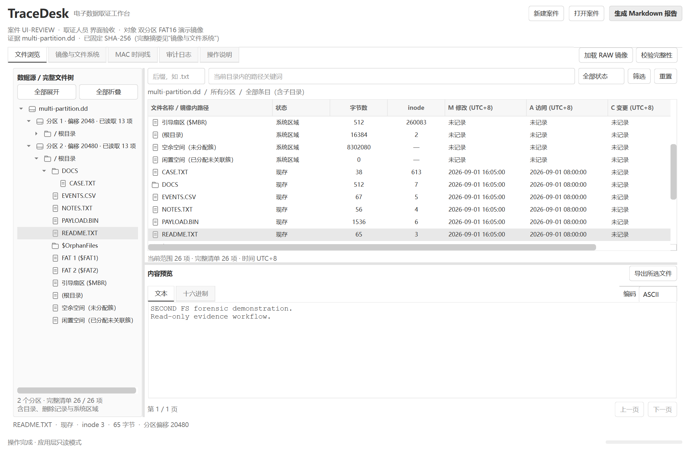

# 白灰文件树工作台：实施与验证

用户确认的设计已接入 PySide6 桌面应用，启动方式保持为项目根目录的 `启动取证工作台.bat`。

## 界面

- 白色主体、浅灰导航与选中项、深灰文字和图标，标题栏与任务栏图标也同步为灰阶。
- 顶部模块标签与“加载 RAW 镜像”“校验完整性”位于同一水平行，文件区紧接导航下方。
- 加载镜像后自动识别并读取所有分区，左侧依次显示镜像、各分区、完整目录层级及文件；删除记录和系统区域保留，不因后缀、路径或状态筛选消失。移除手动分区下拉框和“读取文件树”按钮。
- 右上展示当前目录结果，点击左树文件会定位其父目录，双击右侧目录可进入；列表选中项会展开并定位左树。
- 右下整行显示文本/十六进制预览，支持原有 ASCII、UTF-8、分页、部分读取提示与证据副本导出。按用户圈选移除独立文件属性侧栏，属性与时间仍可在结果列表及底部摘要查看。
- 编码选择位于文本/十六进制标签行右侧，翻页按钮位于预览底部右侧；移除“状态详情”按钮及弹窗，页码与读取提示显示在底部左侧。
- 左右、上下区域使用可拖动分隔条；长路径、全部时间列及预览均可滚动查看。
- 每案固定一个镜像，清单汇总全部分区；不同分区的同名路径、同 inode 分别定位，无法读取的分区保留节点并显示原因。打开未覆盖全部分区的旧案件时自动补齐扫描。

## 验证

验证日期：2026-11-17。使用项目 `.venv`，未新增第三方依赖。

- 全部 49 项回归通过，涵盖界面、启动器、任务队列、UTF-8 跨页、真实 TSK 文件读取、删除文件导出、审计与报告。完整结果保存在 `docs/validation/test-results.txt`。
- 新增覆盖：目录筛选不裁剪左树、树与列表双向定位、同名删除项保持独立、分批显示期间筛选、系统区域禁止文件导出、文本保留换行及跨页字符。
- 使用 `evidence/demo.dd` 实际运行加载、偏移 2048 扫描、目录导航、内容读取、导出、SHA-256 校验与报告生成，全部完成；实际清单为 13 项。
- 在 1440×940 和 1000×720 逻辑像素窗口检查布局；系统为高 DPI 环境，截图按屏幕原始像素保存。
- 沙箱内启动现有 32 位 TSK 曾出现 WinError 623，改用正常本机执行环境验证；一次临时测试案件替换 `case.json` 遇到 WinError 5，单独复核通过。未为环境问题修改取证逻辑。

移除文件属性侧栏后复核：13 项界面回归和 4 项内容预览回归通过；再次使用真实演示镜像检查导航、内容读取、导出、校验及报告，并在两种窗口尺寸下确认预览占满内容区。

自动全分区版本使用自建双 FAT16 分区镜像验证：加载操作自动生成两棵分区树，两个分区内相同路径和 inode 的文件分别读取正确内容；第三个不可读分区的回归夹具验证了错误节点保留及其他分区继续读取。另覆盖扫描期间镜像被修改时不替换旧清单、跨分区导出与报告、旧单分区案件自动补齐。

本次完整回归共 60 项全部通过，结果见 [测试记录](../validation/test-results.txt)；真实桌面在 1440×940 和 1000×720 逻辑像素窗口复核，加载镜像后自动展示 2 个分区、26 个条目。

下图来自真实桌面应用和自建双分区镜像；为同时展示两个分区，将第一个分区的根目录折叠。不是 HTML 设计稿：

