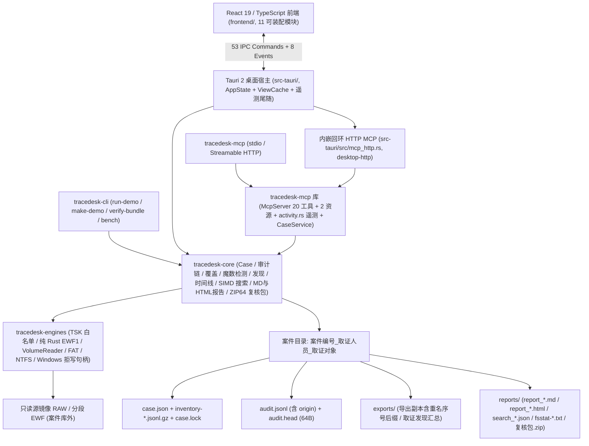

# TraceDesk 设计与验收说明

## 项目目标与技术路线

实现可复现的本地电子数据取证闭环：案件隔离、只读加载、证据固定与范围评估、文件浏览/魔数伪装检测与多格式精确字节预览、内容检索与取证发现、跨模块原文件定位、副本导出、哈希链审计、Markdown/离线 HTML 报告及可独立核验复核包。

技术路线与核心架构（全面采用 **Rust + Tauri 2 + React 19 / TypeScript**，零 Python 运行时依赖）：
- **原生桌面工作台**：Tauri 2（`src-tauri/`）+ React 19 / TypeScript（`frontend/`），复用 Windows 系统 WebView2，采用 **明净瓷白与晴空蓝（Daylight Porcelain & Cerulean Sky）** 浅色取证视觉体系，提供 53 项 Tauri IPC 命令、8 项流式事件与读写分离缓存（`ViewCache`）。
- **核心取证业务库**：`crates/tracedesk-core/` 纯 Rust 实现案件隔离、4 MiB 流式 SHA-256、追加式 SHA-256 审计哈希链与 64 字节 `audit.head` 锚点、大清单 gzip 持久化、MACB 时间线、9 编码跨页与安全图片预览、只读文件头魔数（Magic Bytes）识别与扩展名伪装检测（`magic.rs`）、`memmem` SIMD + Rayon 并行内容搜索、10 章节 Markdown 与离线自包含单文件 HTML 报告（含人工/MCP 协同统计）、ZIP64 复核包构建与跨文件审计链交叉详尽验签，完全独立于界面层，可直接自动化测试。
- **底层只读引擎**：`crates/tracedesk-engines/` 通过参数数组（无 shell）调用随工程分发的官方 Windows 版 The Sleuth Kit 4.15.0 只读白名单命令（`mmls`、`fsstat`、`fls`、`icat`、`img_stat`、`img_cat`），并以纯 Rust 原生实现 EWF1/E01 多段 Rayon 并行解码与校验、RAW/EWF 卷句柄大文件随机读取、NTFS `$MFT` data-runs 非稀疏区间解析、FAT12/16/32 未分配簇及未关联簇区域映射，以及 Windows `FILE_SHARE_READ` 拒写拒删共享句柄。
- **标准 MCP 服务端与 CLI**：`crates/tracedesk-mcp/` 提供原生 `tracedesk-mcp.exe`（20 工具、2 资源、跨进程遥测 `activity.rs`，支持 `stdio` 和仅回环 `Streamable HTTP` + DNS 重绑定防护），桌面端 `src-tauri/src/mcp_http.rs` 直接复用同一 `McpServer` 并在 `McpMonitorModule` 实时可视化展示；`crates/tracedesk-cli/` 提供 `run-demo`、`make-demo`、`verify-bundle` 与 `bench` 子命令。

此文为工程说明与验收材料，不替代学生本人填写期末报告、学习心得和录制演示视频。

## 目录结构与文件说明

完整目录树、模块职责、增删功能指南、按任务查找代码与常用命令集中在 [目录结构与维护指南](目录结构.md)，文档入口见 [文档导航](README.md)。

Rust 工作区包含 5 个成员与独立前端目录：
- `crates/tracedesk-engines/`：只读 TSK 适配、纯 Rust EWF1 多段并行解码、卷随机读取、FAT 空间映射、NTFS 非稀疏区间、4 MiB 流式哈希与 Windows 共享只读句柄。
- `crates/tracedesk-core/`：案件管理、审计链、覆盖评估、目录树索引、时间线、多编码与图片预览、只读文件魔数伪装检测（`magic.rs`）、SIMD 并行内容搜索、取证发现、Markdown 与离线 HTML 报告、ZIP64 复核包（内嵌 `resources/verify_bundle.py`）与跨文件交叉详尽验包器。
- `crates/tracedesk-mcp/`：标准 MCP 服务端（`CaseService` 仅写入瞬间短锁编排、`McpServer` 20 工具 + 2 资源、`activity.rs` 跨进程遥测与统计、`stdio` 与回环 `Streamable HTTP` 传输）。
- `crates/tracedesk-cli/`：演示闭环（`run-demo`）、测试镜像生成（`make-demo`）、原生高速验包（`verify-bundle`）与性能基准测试（`bench`）。
- `src-tauri/` & `frontend/`：Tauri 2 桌面宿主（`AppState`、53 项 IPC、8 项流式事件、跨进程 MCP 遥测尾随与内嵌 HTTP MCP 托管）与 React 19 / TypeScript 工作台界面（11 个可装配模块、13 个公共弹窗含一键复核包核验面板、虚拟滚动表格、MCP 实时监控工作区与 9 份图文操作引导）。

共用目录均通过 `crates/tracedesk-core/src/paths.rs` 的 `AppPaths::discover()` 自动定位，不依赖启动工作目录。`evidence/` 保留原始输入路径，`cases/` 保留案件输出路径，案件库与源镜像严格分离。官方 TSK 的完整 DLL 与 `licenses/` 保留在 `tools/` 原始发行目录中。

## 架构及数据流

### 桌面工作台与视觉体系

界面采用 **明净瓷白与晴空蓝（Daylight Porcelain & Cerulean Sky）** 浅色设计规范（集中定义于 `frontend/src/styles/theme.css`、`app.css` 及 `frontend/src/components/`）：
- **窗口骨架**：顶部明净瓷白命令带（`#FFFFFF`，含精密取证盘片与准星 SVG 徽标、操作说明、MCP 服务直达入口、新建/打开/关闭案件、核验复核包、生成 Markdown / HTML 报告与导出复核包）→ 浅冰色案件保管状态条（`#F7FAFD`，左侧 3 px 语义边框动态区分 `idle` / `active` / `verified` / `warning` / `error`）→ 薄雾浅蓝模块导航标签带（`#EFF4F9`，右侧嵌入加载镜像与校验完整性按钮）→ 浅瓷色侧边栏与纯白证据工作区（`#F7FAFD` / `#FFFFFF`，主色晴空蓝 `#2674C4`，未开案展示最近案件欢迎页与离线复核包核验入口，支持拖拽 `case.json` 与镜像文件打开，原生窗口标题动态显示案件编号与镜像名）→ 底部浅瓷色只读状态、长任务取消与进度/ETA 遥测栏。
- **统一视觉组件**：`SemanticPill` 渲染现存/已删除/重分配/系统区域/人工/MCP/MACB 与魔数高危/中危语义胶囊；`VirtualTable` 支撑大清单高帧率滚动；`FilterHeader` 提供表头下拉多选、三态全选与正倒序切换；`PreviewPane` 提供 9 编码文本、十六进制（弱化空字节、支持精确字节范围与右侧 ASCII 联动高亮、支持 `0x`/十进制字节偏移跳转及当前页文本/HEX 一键复制）、等比例安全图片预览以及文件魔数元信息/伪装告警栏；`Icons.tsx` 提供本地高 DPI 矢量图标。
- **读写分离与线程安全**：`src-tauri/src/state.rs` 通过 `ViewCache` 与后台线程通道隔离耗时 IO/扫描/大镜像校验/三段式无锁并行内容搜索任务，前端通过 8 项 Tauri Events（含 `mcp:activity` 与 `mcp:case-updated`）实时接收进度、流式搜索命中与跨进程遥测更新；后台采用 `disk_dirty` 标志配合非阻塞重载，若跨进程通知到达瞬间发生写锁竞争，锁释放后主动补刷磁盘最新状态，确保大镜像校验、内容搜索与 MCP 协同期间界面流畅且数据一致。
- **一键启动器**：`启动取证工作台.bat` 优先直接拉起 `target\release\tracedesk-desktop.exe`；若尚未编译则自动检测并构建 `frontend\dist` 与 Rust Release 二进制后启动工作台。

## 需求对应与验收方法

### 课程七项基本功能

| 评分功能 | 实现位置 | 验收依据 |
| --- | --- | --- |
| 新建/打开案件与元数据 | `tracedesk-core::Case::create` / `Case::open`、`NewCaseDialog` / `OpenCaseDialog` | 重开后保留清单、发现与导出记录；相同编号按目录自动加 ` (2)` 序号隔离；UUID 独立 |
| RAW / EWF 加载、分区和文件系统 | `Case::load_image`、`TskCli::inspect`、`Case::scan_partitions`、`tracedesk-engines::ewf` | 自动识别 MBR/GPT 多分区与偏移 0 卷；不可读分区保留原因；分段 EWF 从 `.E01` 加载；旧案件自动补齐扫描 |
| SHA-256 固定与校验 | `tracedesk-engines::sha256_file`、`Case::verify_integrity`、`ewf::verify_ewf_logical` | 与独立摘要及采集记录一致；篡改后校验失败并阻断导出与复核包生成 |
| 文件树、大小、MACB、筛选与预览 | `TskCli::list_files`、`BrowserIndex`、`FileBrowserModule`、`PreviewPane` | 递归 `DOCS/CASE.TXT`；后缀、关键词、状态筛选；文本（9 编码）/图片/十六进制分页预览 |
| 关键操作审计 | `Case::log`、`Case::check_audit`、`AuditLogModule` | UTC+8 时间、人工 / `MCP · <使用者>` 来源与调用方身份、主体、对象、结果；篡改或截断检出 |
| 现存与已删除文件导出 | `Case::export`、`TskCli::export_file` / `export_deleted` | 夹具文件逐一核对预期哈希与长度；重名时不再创建子目录，直接在 `exports/` 下追加 `(1)`、`(2)` 等序号后缀（如 `NOTES(1).TXT`）；已删除支持部分恢复说明；目录拒绝导出；单文件导出结果弹窗提供“记为取证发现”快捷入口 |
| Markdown 与离线 HTML 报告 | `Case::report`、`Case::generate_html_report`、`tracedesk-core::reporting` | 10 章节 Markdown 报告（清单按发现/导出/已删除优先抽样、EWF 逐段摘要明细、审计首尾保留与人工/MCP 协同统计）及离线自包含单文件 HTML 报告（零外链 CDN、吸顶目录、打印友好） |

### 扩展能力与对应模块

| 扩展能力 | 实现位置 | 核心要点 |
| --- | --- | --- |
| 分段 EWF 与卷声明范围评估 | `tracedesk-engines::ewf`、`tracedesk-core::coverage` | 纯 Rust EWF1/E01 多段 Rayon 并行解码（支持 `.E99` 后字母续段，501.69 MiB/s）；解析 Guymager `.info` 参照；区分哈希一致性与 NTFS/FAT 卷声明范围 |
| 大容量镜像（≥1 GiB）按需分析 | `tracedesk-core::case`、`tracedesk-engines::volume`、`browser_index.rs`、`preview.rs` | 打开直达首个可读根目录（LRU 目录缓存）；支持按需“仅索引此分区”与后台可取消完整索引、带已耗时/ETA 估算的整镜像哈希校验；常规与已删除 NTFS 文件优先经 `VolumeReader` 进程内随机读取预览，`icat` 临时缓存设 64 MiB 截断上限；Windows 拒写共享句柄；大清单压缩为 `inventory-*.jsonl.gz` |
| 高性能内容搜索与实时复核 | `tracedesk-core::content_search`、`tracedesk-engines::ntfs`、`ContentReviewModule` | UTF-8/UTF-16LE/GBK/HEX 精确字节三段式无锁并行搜索（搜索期间不阻塞保存发现与 MCP 读写），AVX2 `memmem` SIMD + Rayon 并行（14.44 GiB/s 扫描吞吐）、流式实时展示与底栏取消、硬链接去重、NTFS 非稀疏区间切分、历史搜索记录回放、二次路径/删除状态筛查与恢复已排除项 |
| 只读文件头魔数识别与扩展名伪装检测 | `tracedesk-core::magic`、`FileBrowserModule`、`PreviewPane` | 仅只读读取前 4 KiB 原始字节（绝不解压 ZIP/OOXML/GZIP/RAR，杜绝 Zip Bomb），识别 25 类二进制签名（PE/ELF/Mach-O/LNK/PDF/SQLite/OLE2/DOCX/XLSX/PPTX/压缩包/图像/音视频），高危可执行/快捷方式与中危跨类型分级；支持 Rayon 并行全案无锁扫描、文件列表「仅看疑似伪装」聚合过滤、预览魔数元信息与告警条一键预填记为取证发现 |
| 跨模块一键定位原文件与 HEX 精确检视 | `FileBrowserModule`、`PreviewPane`、`TimelineModule`、`FindingsModule`、`ContentReviewModule`、`HexHitPreviewDialog` | 在 MACB 时间线、取证发现、内容搜索命中行与十六进制命中弹窗均可一键“定位原文件”，自动切至文件浏览、清理阻塞筛选、翻页滚动选中目标并自动切换 HEX 视图高亮精确字节区间与右侧 ASCII；预览面板同步支持 `0x`/十进制字节偏移回车跳页与当前页文本/HEX 快捷复制 |
| 文件级取证工具与发现一键导出 | `tracedesk-core::file_tools`、`findings.rs`、`FindingsModule` | 文件预览区顶部栏、单文件导出结果弹窗及右键菜单均支持记录取证发现，右键另支持计算单文件 SHA-256 与比对本地副本；发现页按文件归组并支持一键批量导出副本及汇总 Markdown |
| 离线自包含 HTML 报告与人工/MCP 协同统计 | `tracedesk-core::reporting`、`Case::generate_html_report`、`ExportResultDialog` | 生成零外链 CDN 单文件 `reports/report_*.html`（明净瓷白与晴空蓝视觉、吸顶导航目录、人工 vs MCP 协同统计卡片、`
` 折叠明细、严格 HTML 转义防 XSS、`@media print` 打印样式）并记入 `REPORT_GENERATE` 审计链；结果弹窗展示 SHA-256/大小/时间，支持复制路径、直接打开文件与打开所在目录 |
| 可移交复核包、跨文件交叉核对与一键可视化核验 | `tracedesk-core::review`、`resources/verify_bundle.py`、`tracedesk-cli verify-bundle`、`VerifyBundleDialog` | 导出复核包时自动同步生成并一并打包最新 `report.md` 与 `report.html`，连同副本、搜索记录、审计链、`manifest.json`、`SHA256SUMS.json` 与核验脚本生成 ZIP64 包及 `.zip.sha256`（核验向后兼容不含 `report.html` 的历史复核包）；原生与 Python 核验均补齐 `report.md`/`report.html`/`searches/*.json`/`manifest.exports`/`manifest.findings` 与 `audit.jsonl` 的跨文件一致性核对；桌面端未开案即可点击「核验复核包」自动读取 `.zip.sha256`、逐成员对比期望/实测哈希并直观标红受损成员与断链位置 |
| 标准 MCP 服务端、跨进程遥测与来源追踪 | `crates/tracedesk-mcp/`（含 `activity.rs`）、`src-tauri/src/mcp_http.rs`、`McpMonitorModule.tsx` | 20 工具 + 2 资源（含 `tracedesk_read_search_report` 只读分页翻阅已落盘搜索报告）；`stdio`（暖启动 33.72 ms）与仅回环 `Streamable HTTP`（DNS 重绑定 `421`/`403` 防护、16 MiB 请求上限、请求帧安全加固）；桌面端内嵌 `desktop-http` 与独立 `streamable-http` / `stdio` 统一接入 `activity.rs` 跨进程遥测与 `McpMonitorModule` 实时监控工作区（单步参数/结果透视、20 工具统计与配置复制）；采用仅写入瞬间短锁 + 案件自动热刷新（含 `disk_dirty` 延迟补刷）；自动采集 `initialize` `clientInfo`、`Mcp-Session-Id`、`X-MCP-User`/`X-MCP-Client`/`User-Agent`、`--actor`/`TRACEDESK_MCP_ACTOR` 并确保遥测调用方与 `audit.jsonl` SHA-256 哈希链内 `MCP · <使用者>` 身份完全一致 |

## 关键模块与案件持久化格式

### 案件目录与元数据（完全向后兼容历史案件）

`case.json` 保存案件 UUID、编号、人员、对象、建立时间、原始证据信息（路径、格式、大小、固定摘要与时间、分区、覆盖评估、EWF 分段清单、登记来源）、`partition_scans`、导出清单、最近校验记录及 `fsstat` 摘要。非空文件清单以 gzip 压缩 JSONL 形式写入同目录 `inventory-<uuid>.jsonl.gz`，并在 `case.json` 中记录 `inventory_file` 与 `inventory_count`（打开旧版内联清单案件时自动迁移）。
- `exports/`：保存导出副本（遇到重名时不再创建子目录，直接在 `exports/` 下于文件名后追加 `(1)`、`(2)` 等序号后缀，如 `NOTES(1).TXT`）及取证发现一键导出生成的 `取证发现汇总_*.md`。
- `reports/`：保存 Markdown 取证报告（`report_*.md`）、离线单文件 HTML 取证报告（`report_*.html`）、内容搜索详情清单（`search_*.json`）、大镜像按需导出的完整文件系统详情（`fsstat-*.txt`）以及可移交复核包（`report_*.zip` 与 `.zip.sha256`）。
- 原始镜像绝不复制进案件库，并拒绝加载位于整个案件库目录内的镜像文件。

### 审计哈希链与复核包互验

审计日志 `audit.jsonl` 每条记录包含 `seq`、`timestamp`、`actor`、`origin`（`manual` 或 `mcp`）、`action`、`subject`、`result`、`details`、`previous`、`hash`；来源为 `mcp` 时自动采集的使用者与客户端身份（`initialize` `clientInfo`、`Mcp-Session-Id`、`X-MCP-User`/`X-MCP-Client`/`User-Agent`、`--actor`/`TRACEDESK_MCP_ACTOR`）同步写入记录并纳入哈希计算，在审计日志、取证发现、Markdown/HTML 报告与 `tracedesk_query_audit_log` 中统一以 `MCP · <使用者>` 呈现。`hash` 为除自身外按字典序规范化 JSON 的 SHA-256，追加并 `fsync` 落盘后更新精确 64 字节 ASCII `audit.head` 尾部锚点（无换行符）。重开案件、继续写入、生成报告和核验复核包前均校验整链与尾部锚点；接收方取得独立渠道交付的 ZIP SHA-256 后，可通过桌面工作台「核验复核包」可视化面板、`tracedesk-cli verify-bundle` 或包内附带的 `verify_bundle.py` 离线核验全部成员哈希、审计链及跨文件审计链一致性（`report.md`、`report.html`、`searches/*.json`、`manifest.exports` 与 `manifest.findings` 对照 `audit.jsonl`）。

## 合规设计与边界

本项目依据课程文档提出的只读、完整性、可审计原则设计实现，不作 SF/T 0146-2023 全条款符合性声明或法定资质认证声明。未取得标准全文逐条评审，也未引入硬件写保护器或第三方可信时间戳/签名服务。

应用层控制与已知边界如下：
- **只读与隔离**：源镜像只读打开，TSK 仅限读取白名单，案件库与源镜像分目录隔离；大镜像会话与受保护内容搜索使用 Windows `FILE_SHARE_READ` 共享句柄阻止其他进程写入或删除，但无法替代硬件写阻断器，亦无法在物理介质层面强制隔离（要求跨物理介质时须由操作人员部署到不同设备）。
- **日志防篡改边界**：审计哈希链与 `audit.head` 可检测单方面修改、删除或截断，但不能防御对案件目录拥有完整本地写权限者同时重写 `audit.jsonl`、`audit.head` 与 `case.json`。
- **案件并发与网络边界**：桌面端与 MCP 服务统一采用“仅写入瞬间短锁 + 跨进程案件自动热刷新”机制：案件浏览期间不长期占用 `case.lock`，受控写入瞬间排队获取独占文件锁、同步磁盘指纹并落盘后立即释放；当任意 MCP 进程完成受控写入时，宿主发出 `mcp:case-updated` 并触发非阻塞热刷新，若瞬间遭遇写锁竞争（`WouldBlock`）则置位 `disk_dirty` 并在锁释放后主动补刷磁盘最新状态再补发通知，杜绝前端假刷新。本地 MCP HTTP 服务仅限回环访问（带 Host/Origin 校验与请求帧安全加固），不对外网暴露。
- **解析与检索边界**：仅支持 512 字节扇区的 RAW 与分段 EWF1 镜像；卷声明覆盖范围判定仅覆盖可识别的 NTFS/FAT 引导扇区与分区表，不能证明原盘无坏扇区或已完整采集；内容搜索仅针对清单内可读文件及删除记录，不解压归档文档、不扫描未分配空间；未实现无目录项文件雕刻、加密卷解密或异常分区修复。

## 系统测试与实测验证

执行环境：Windows 11 x86_64（Intel i9-14900HX，32 线程），Rust `1.100.0`（Edition 2024），Node.js `v24.19.0` / React 19 / Tauri 2，官方 The Sleuth Kit 4.15.0 Windows。

全栈验收门禁命令：
- 前端类型检查与生产构建：`Set-Location frontend; npm.cmd run build`（`tsc --noEmit && vite build` 零错误）
- Rust 静态检查门禁：`cargo clippy --workspace --all-targets -- -D warnings`（零警告）
- 全工作区自动化测试：`cargo test --workspace`（覆盖全部 5 个 crate，真实调用 TSK，无 Python 环境 100% 自包含通过）：
  - `tracedesk-engines`：EWF1 多段并行解码、FAT 空间区域映射、NTFS 非稀疏区间、真实 TSK 镜像加载/扫描/导出与 Windows 拒写句柄测试；
  - `tracedesk-core`：规范化 JSON、审计链篡改检测（含等长同 mtime 篡改）、`case.lock` 锁隔离与旧清单迁移、覆盖范围评估、大目录分桶与分页、跨页 GBK/UTF-16LE 与图片预览上限、只读文件头魔数识别与伪装检测、SIMD 流式内容搜索、Markdown 与离线 HTML 报告（含人工/MCP 协同统计）、复核包跨文件审计链交叉核对与篡改拒签、端到端闭环与双向兼容测试；
  - `tracedesk-mcp`：20 工具全流程（含 `tracedesk_read_search_report` 只读分页与防路径穿越）、多分区同名/删除文件消歧、锁冲突保护、跨进程遥测尾随与 `desktop-http` 通道/调用方身份对齐、`stdio` 与 `Streamable HTTP`（DNS 重绑定 421/403、根路径 404、16 MiB 上限、帧加固）集成测试；
  - `tracedesk-cli`：`run-demo`、`make-demo`、`verify-bundle` 子命令集成测试；
  - `tracedesk-desktop`：桌面宿主 `AppState`、跨进程 MCP 遥测尾随、`disk_dirty` 延迟热重载、无锁内容搜索/历史回放书签、HTML 报告与离线复核包详尽核验/篡改检出、魔数全案扫描与单条目识别、跨模块原文件定位及内嵌 HTTP MCP 委托集成测试。

实测与验证记录：
- Rust (`--release`) vs Python 3.13 性能对比与双向兼容实测：[Rust 迁移性能对比实测](validation/Rust迁移性能对比实测.md)
- 分段 EWF 加载、浏览与复核实测：[EWF 加载与复核实测](validation/EWF加载与复核实测.md)
- 历史回归输出归档：[test-results.txt](validation/test-results.txt)

测试边界说明：尚未对超大容量实体磁盘的整盘哈希/穷举搜索、坏扇区介质、BitLocker/LUKS 等加密文件系统、无目录项雕刻或硬件写保护设备进行测试，不能将当前测试结论外推到这些场景。

## 特色能力与后续改进空间

已完成的主要特色能力包括：全原生 Rust + Tauri 2 零 Python 运行时架构、可检测篡改与人工/MCP 来源的 SHA-256 审计哈希链、只读文件头魔数识别与扩展名伪装检测、跨模块一键定位原文件与 HEX 精确字节高亮/偏移跳转、极速 MACB 时间线与表头筛选排序、纯 Rust EWF1 多段并行校验与 ≥1 GiB 大容量镜像按需浏览、AVX2 SIMD + Rayon 并行内容搜索与流式复核、离线自包含单文件 HTML 报告（含人工/MCP 协同统计）、支持跨文件审计链交叉核对与桌面端一键可视化验签的 ZIP64 复核包、标准 MCP 服务端与桌面端内嵌托管，以及明净瓷白与晴空蓝浅色取证界面。

后续可继续深化的方向：引入外部可信时间戳（RFC 3161）与数字签名以增强证据包防抵赖能力、增加无目录项文件雕刻模块、补充 ext4/exFAT/APFS 等文件系统专项回归夹具、引入独立物理介质校验提示，以及将超大清单和时间线进一步改造为磁盘分页/流式索引以降低极端文件数量下的内存占用。
