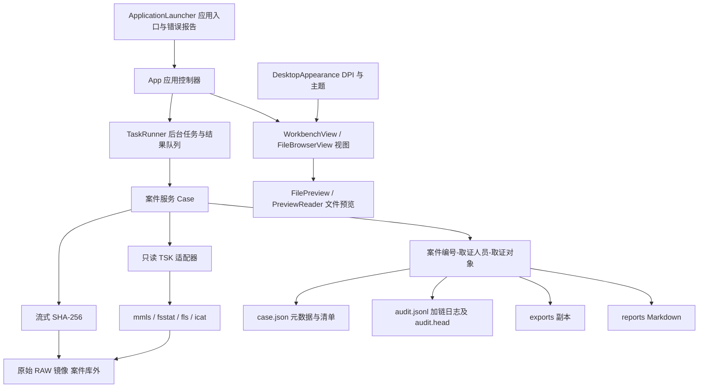

# TraceDesk 设计与验收说明

## 项目目标与技术路线

实现可复现的取证闭环：建立案件、只读加载、证据固定、文件分析、导出副本、审计及报告。根据课程建议以目录与 JSON 隔离案件，以 Python subprocess 调用 TSK 的命令行组件。PySide6（Qt 6）提供本地中文界面，业务层独立于界面，可直接自动化测试。Python 第三方依赖均安装到项目 `.venv`。

此文为工程说明与验收材料，不替代学生本人填写期末报告、学习心得和录制演示视频。用户提供的两份原始 Word 文档保持原样。

## 目录结构与文件说明

下列结构以项目根目录 `TraceDesk` 为起点，列出程序源码、随附资源和按需生成的运行目录。案件子目录使用命名规则示意，不代表固定的演示案件；本机另行放入的证据镜像和 Python 缓存不逐项列出。

```text
TraceDesk/
├─ main.py                         # 程序入口，调用应用启动器
├─ 启动取证工作台.bat              # 创建/使用项目虚拟环境，安装缺失依赖并启动
├─ requirements.txt                # Python 第三方依赖及版本范围（PySide6）
├─ README.md                       # 环境准备、操作流程与验证命令
├─ THIRD_PARTY_NOTICES.md           # 第三方来源、许可证与 AI 使用说明
├─ .gitignore                      # 本地环境、运行数据及构建产物的忽略规则
├─ forensic/                       # 取证程序源码
│  ├─ __init__.py                  # Python 包标记
│  ├─ launcher.py                  # 启动协调、异常弹窗与错误日志
│  ├─ gui.py                       # 界面控制器，协调案件操作和后台结果
│  ├─ workspace.py                 # 主窗口布局、文件树、筛选和分批显示
│  ├─ views.py                     # 新建案件对话框与只读文本面板
│  ├─ appearance.py                # Qt 字体、高 DPI 布局与浅色暖色主题
│  ├─ branding.py                  # 应用图标、Windows 任务栏身份与资源定位
│  ├─ tasks.py                     # 串行后台任务及结果队列
│  ├─ preview.py                   # 只读内容读取、十六进制/字符预览与分页
│  ├─ core.py                      # 案件、SHA-256、审计链、导出与报告
│  ├─ tsk.py                       # TSK 只读命令适配与输出解析
│  ├─ fat.py                       # FAT 空间区域及簇分配分析
│  └─ assets/                      # 随程序分发的图标资源
│     ├─ tracedesk.svg             # 图标矢量源文件
│     ├─ tracedesk.ico             # Windows 多尺寸图标
│     └─ tracedesk.png             # PNG 图标预览
├─ scripts/                        # 环境、演示、资源和打包辅助脚本
│  ├─ install_tsk.ps1              # 下载、校验并解压官方 TSK 发行包
│  ├─ make_demo.py                 # 构建确定性的 FAT16 演示镜像与校验清单
│  ├─ run_demo.py                  # 执行取证闭环；--gui 打开展示案件
│  ├─ make_icon.py                 # 从 SVG 生成 PNG 和多尺寸 ICO
│  └─ package.py                   # 生成可提交的源码工程 ZIP 包
├─ tests/                          # 自动化回归测试
│  ├─ test_workflow.py             # 真实 TSK 取证流程、证据保护与审计校验
│  ├─ test_tasks.py                # 后台任务串行执行及结果交接
│  ├─ test_gui.py                  # Qt 控制器、窗口生命周期和文件树
│  ├─ test_preview.py              # 文件选择、分页、编码及删除记录预览
│  └─ test_launcher.py             # 启动异常、日志与异常处理器恢复
├─ docs/                           # 工程说明与验证记录
│  ├─ 设计与验收说明.md            # 本文：结构、设计、需求对应及边界
│  └─ test-results.txt             # 实际测试输出记录
├─ tools/
│  └─ sleuthkit-4.15.0-win32/       # 官方第三方 TSK 工具，保留原始发行结构
│     ├─ bin/                      # 命令行程序与运行 DLL；本程序使用 mmls/fsstat/fls/icat
│     ├─ lib/                      # 上游随附库文件
│     ├─ licenses/                 # TSK 及其第三方组件的许可证
│     └─ README*.txt、NEWS.txt      # 上游使用说明与发行记录
├─ evidence/                       # 随工程提供的演示证据及独立校验清单
│  ├─ demo.dd                      # 带 DOS 分区表的 FAT16 镜像，卷偏移 2048 扇区
│  ├─ demo.manifest.json           # demo.dd 的预期哈希及镜像内文件的大小/哈希
│  ├─ demo_volume.dd               # 无分区表的 FAT16 卷镜像，偏移 0
│  └─ demo_volume.manifest.json    # 卷镜像的预期哈希及镜像内文件的大小/哈希
├─ cases/                          # 默认案件库，实际内容由运行生成
│  ├─ .gitkeep                     # 源码包中的空目录占位
│  └─ 案件编号-取证人员-取证对象/   # 每次新建案件独立建目录；重名添加 (2)、(3) 等
│     ├─ case.json                 # 案件元数据、证据固定值、文件清单和导出记录
│     ├─ audit.jsonl               # 追加式审计哈希链
│     ├─ audit.head                # 最近一条审计记录的哈希锚点
│     ├─ case.lock                 # Windows 案件占用锁文件
│     ├─ exports/                  # 导出副本；重名副本保存在独立子目录
│     └─ reports/                  # 生成的 Markdown 报告
├─ .venv/                          # 本项目 Python 解释器与第三方依赖，首次准备环境时创建
├─ logs/                           # 发生启动/回调异常时生成 startup.log
├─ dist/                           # 打包脚本生成的源码工程 ZIP
└─ .test-work/                     # 自动化测试的临时案件和镜像工作目录
```

`forensic`、`scripts` 和 `tests` 保存项目源码；`tools/sleuthkit-4.15.0-win32` 保存官方第三方工具，运行时需要保留其 DLL 与许可证。`evidence` 中的演示镜像及 manifest 是验证输入，manifest 给出独立生成的预期值。`cases` 保存分析输出，源镜像必须位于整个案件库之外；案件库也可由用户选择其他目录。

`.venv`、`logs`、`dist`、`.test-work` 和具体案件内容属于本地环境或运行生成内容。源码工程包保留 `cases/.gitkeep`，不携带本机已生成的案件、虚拟环境和缓存。`run_demo.py` 还会按需生成 `docs/latest-demo.txt`，记录最近一次演示案件路径，该本机路径文件不放入源码工程包。关闭或切换案件会释放 `case.lock` 持有的系统文件锁，锁文件本身可保留在案件目录中。

## 架构及数据流



GUI 将耗时任务放到后台线程，以队列将结果交回 Qt 主线程，通过 `QTimer` 定时消费结果。执行期间禁止切换案件和关闭应用，防止任务写入错误案件。目录名由案件编号、取证人员和取证对象组成。路径分隔符等禁用字符替换为下划线，重名时添加序号；案件元数据保留独立 UUID。

2026-11-11 界面迁移为原生 PySide6 控件，采用浅色主题，以暖米白、砂岩和棕金配色。保留 `Case`、`TSK` 和案件文件格式，布局、主题、对话框、文件树批次显示、任务队列与操作协调分别由独立类负责。主线程消费 `TaskResult` 后更新控件，工作线程不操作 Qt 控件。文件树分批插入，重新加载清单时取消尚未完成的批次；字节数和 inode 两列的标题与数据保持居中。

BAT 启动脚本切换到项目目录，首次创建 `.venv`，仅在 PySide6 缺失时补齐 pip 并通过清华镜像安装依赖，再通过 `.venv\Scripts\python.exe main.py` 启动；保留终端窗口，运行失败时暂停。Qt 6 自动处理高 DPI 缩放，窗口按屏幕可用工作区放置。应用入口和 Qt 回调异常写入日志并弹窗显示，退出事件循环时恢复原有 `sys.excepthook`。

## 需求对应与验收方法

| 评分功能 | 实现位置 | 验收依据 |
| --- | --- | --- |
| 新建/打开案件与元数据 | Case.create、Case.__init__ | 重开后保留导出记录；相同编号隔离 |
| RAW 加载、分区和文件系统 | Case.load、TSK.inspect、Case.scan | 真实 mmls 分区偏移 2048；fsstat；偏移 0 卷测试 |
| SHA-256 固定与校验 | sha256、Case.verify | 与独立 hashlib 结果一致；篡改后校验失败 |
| 文件树、大小、MAC、后缀 | TSK.files、GUI.display、Case.filtered | 递归 DOCS/CASE.TXT；TXT 与关键词过滤 |
| 关键操作审计 | Case.log、Case.check_audit | 显示东八区（UTC+8）时间、主体、对象、结果；修改/截断检测 |
| 现存与已删除文件导出 | Case.export、TSK.export | 5 个文件逐一与独立夹具哈希及长度比较；目录拒绝导出 |
| Markdown 报告 | Case.report | 案件、原证据哈希、日志摘要、文件摘要、结论、确认栏；无 HTML 报告 |

## 关键模块

`case.json` 保存案件编号、人员、对象、创建时间、原始证据路径/哈希/大小/固定时间/分区、当前分区清单、导出清单及最近校验结果。`exports` 仅存副本；`reports` 仅存 Markdown。原始镜像不复制进案件库。案件库与镜像分属目录，跨物理介质仍需部署操作保证。

TSK 调用以参数数组执行且不启用 shell；工具名仅限读取白名单。mmls 提取分区起始扇区；无分区表时由 fsstat 确认偏移 0 文件系统。fls 分别使用 `-u` 和 `-d` 递归读取现存和已删除目录项，保留每条记录的路径、inode、类型、长度、时间和分配状态。文件树保留 TSK 虚拟条目。FAT 空间视图按分配表和现存目录项引用的簇链计算。MAC 分别是修改、访问、元数据变更，B 为创建。无时区文件系统按 UTC 解释，界面按东八区显示。

哈希每次读取 1 MiB，内存占用不随镜像大小增长；对已打开文件比对读取前后身份、长度、修改时间。导出前后重新计算完整镜像哈希；现存文件要求导出大小与目录记录一致。已删除文件沿用预览的读取方式，保存最多至目录记录大小的可读字节，并记录实际长度、簇占用或 inode 重分配信息及副本哈希。非空记录未能读出任何字节时，导出失败。哈希一致只能证明本次读取内容一致，无法替代写阻断或防范恶意并发替换路径。

审计记录字段：seq、timestamp、actor、action、subject、result、details、previous、hash。hash 是除自身外的规范化 JSON 与前序摘要的 SHA-256。追加并 fsync 后写入 audit.head。重开案件或继续追加前验证整链与尾部锚点；程序不提供编辑/删除日志入口。双文件更新在断电时可能不一致，此时失败关闭，需要保留现场另案检查，不能直接“修复”原日志。

报告生成时重新读盘校验；不匹配时明确写“不通过”，不伪造成功结论。报告记录当前文件清单最多 200 项、最近 100 条审计和全部导出记录，完整清单与日志仍在案件文件。报告包括生成开始事件，报告成功事件在文件写成后追加至原日志；报告内锚点对应生成时快照。

## 合规设计与边界

本项目根据课程文档提出的只读、完整性、可审计原则实现，不作 SF/T 0146-2023 全条款符合性声明或认证声明。未取得标准全文逐条评审，也未引入硬件写保护或可信签名服务。目录分离、追加接口、哈希链是应用层控制；有本地写权限者仍能改动 JSON 和原镜像。Windows 使用文件锁限制同一案件同时打开，切换案件或退出时释放。

## 系统测试

执行环境：Windows，Python 3.13，PySide6（Qt 6），官方 The Sleuth Kit 4.15.0 Windows。用纯 Python 构建 9 MiB（带分区表）和 8 MiB（卷）FAT16 镜像，包含根目录、子目录、UTF-8 文本、CSV 和跨簇二进制文件。文件内容由生成器独立给出预期哈希，不以被测导出结果反推预期。

`docs/test-results.txt` 保存实际测试输出。测试包括完整真实 TSK 主链路、偏移 0 卷、筛选、镜像篡改后导出阻断与失败报告、日志修改检测、日志截断检测、同编号案件隔离与镜像位置约束、坏镜像失败审计、目录导出拒绝、跨缓冲区哈希。未进行大容量/坏扇区/加密文件系统/NTFS 多属性/并发进程测试，不能将课程测试结果外推到这些场景。

开发环境中的沙箱会导致官方 TSK 出现 WinError 623，已在获准的正常 Windows 进程环境执行真实测试；测试文件仍只写入本项目。该现象与镜像解析逻辑无关。

## 个性化功能与改进空间

审计哈希链增加对篡改的可见性；MAC/B 时间线帮助定位文件活动；导出副本哈希和前后校验把文件导出纳入证据链。后续可增加外部签名/可信时间戳、流式清单索引、任务取消、更多文件系统夹具及独立物理介质检测。

AI 参与范围见根目录 THIRD_PARTY_NOTICES.md。学生需要亲自读懂关键代码，补充真实操作截图、独立心得、姓名学号，并录制 3–5 分钟流程；这些学习材料未被虚构或代签。
