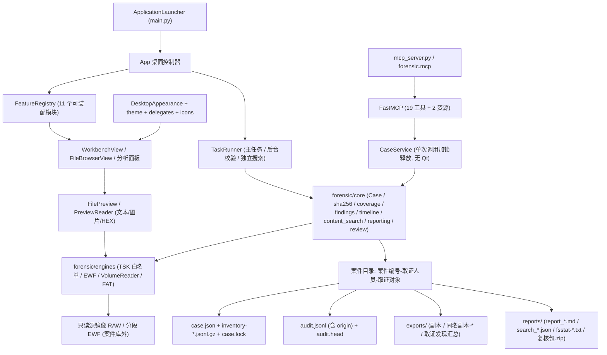

# TraceDesk 设计与验收说明

## 项目目标与技术路线

实现可复现的本地电子数据取证闭环：案件隔离、只读加载、证据固定与范围评估、文件浏览与多格式预览、内容检索与取证发现、副本导出、哈希链审计、Markdown 报告及可独立核验复核包。

技术路线与核心依赖（第三方 Python 依赖均安装到本项目 `.venv`）：
- **桌面工作台**：PySide6（Qt 6），采用原生控件与模块化 QSS 打造 **Archival Slate & Prussian Ink** 专业取证视觉体系。
- **核心业务与标准库**：案件隔离、4 MiB 复用缓冲流式 SHA-256、追加式 SHA-256 审计哈希链、MACB 时间线、Markdown 报告与复核包均由 Python 标准库实现，完全独立于 Qt，可直接自动化测试。
- **底层只读引擎**：通过参数数组（无 shell）调用随工程分发的官方 Windows 版 The Sleuth Kit 4.15.0 只读白名单命令（`mmls`、`fsstat`、`fls`、`icat`、`img_stat`、`img_cat`），解析 RAW 与分段 EWF（`.E01`）镜像；借助 `pytsk3` 与 `libewf-python` 支持大文件随机读取、EWF 逻辑介质解码与多进程内容检索；纯 Python 解析 FAT12/16/32 未分配簇及未关联簇区域。
- **标准 MCP 服务端**：基于官方 Python `mcp` SDK（FastMCP）提供 `tracedesk_mcp` 服务端（19 个工具、2 个资源），支持 `stdio` 和仅监听本机回环的 `Streamable HTTP`，并可在桌面端内一键启停与配置。

此文为工程说明与验收材料，不替代学生本人填写期末报告、学习心得和录制演示视频。

## 目录结构与文件说明

完整目录树、模块职责、增删功能指南、按任务查找代码与常用命令集中在 [目录结构与维护指南](目录结构.md)，文档入口见 [文档导航](README.md)。

源码位于 `forensic/`，按职责划分为五个子包：
- `forensic/core/`：不依赖 Qt 的案件管理、哈希、审计、覆盖评估、内容搜索、取证发现、时间线、预览读取、报告、复核包与后台任务调度。
- `forensic/engines/`：只读 TSK 适配、分段 EWF 校验与采集信息读取、`pytsk3`/`pyewf` 卷句柄随机读取、FAT 空间区域映射。
- `forensic/features/`：11 个可按需启停的功能模块（`cases`、`evidence`、`files`、`export`、`file_tools`、`report`、`timeline`、`audit`、`help`、`mcp`、`review`）及注册表。
- `forensic/mcp/`：不依赖 Qt 的标准 MCP 服务端（业务编排 `CaseService`、FastMCP 工具/资源定义与本地 HTTP 生命周期管理 `LocalHttpMcpManager`）。
- `forensic/ui/`：PySide6 控制器、窗口骨架、主题令牌与样式、语义胶囊/十六进制委托、高 DPI 图标、目录树、分析面板与公共弹窗。

共用目录均从 `forensic/paths.py` 解析，不依赖启动工作目录。`evidence/` 保留原始输入路径，`cases/` 保留案件输出路径，案件库与源镜像必须分离。官方 TSK 的完整 DLL 与 licenses 保留在 `tools/` 原始发行目录中。源码包（`scripts/package.py`）打包源码、测试、脚本、官方 TSK、指定说明文档、4 份自建演示文件及 `cases/.gitkeep`，不携带本机案件、私人证据、日志、虚拟环境和缓存。

演示脚本将最近案件位置写入 `logs/latest-demo.txt`。关闭或切换案件会释放 `case.lock` 持有的系统文件锁，锁文件本身可保留在案件目录中。

## 架构及数据流

### 桌面工作台与视觉体系

界面全部使用 PySide6 原生控件，采用 **Archival Slate & Prussian Ink** 设计规范（集中定义于 `forensic/ui/theme.py`、`appearance.py`、`delegates.py`、`icons.py`、`branding.py`、`metrics.py`）：
- **窗口骨架**：顶部深岩青命令带（`#15202E`，48 px，含 SVG 按 DPR 光栅化的精密盘片准星徽标、操作说明、MCP 服务、新建/打开案件、生成报告与导出复核包）→ 案件保管状态条（左侧 3 px 语义边框动态区分 `idle` / `active` / `verified` / `warning` / `error`）→ 模块导航标签带（右侧嵌入加载镜像与校验完整性按钮）→ 日光冷灰/纯白工作区（`#E8EDF3` / `#FFFFFF`，主色普鲁士蓝 `#1B4D89`）→ 底部只读状态与进度遥测栏（28 px，左侧文件摘要、右侧只读模式与任务进度条）。
- **统一渲染委托与图标**：`ForensicItemDelegate` 为取证表格与文件树提供语义胶囊徽章（现存/已删除/重分配/系统区域/人工/MCP/MACB 事件）、等宽数字与时间戳列、静默占位与 2.5 px 普鲁士蓝选中导轨；`HexItemDelegate` 渲染十六进制偏移、字节列与解码字符列并弱化空字节；`icons.py` 本地矢量绘制 2× HiDPI 文件类型图标与界面操作图标。
- **安全字体构造**：通过 DirectWrite 可用字体检测动态构建字体族，界面正文优先 `Segoe UI Variable Text` / `Segoe UI` 搭配 `Microsoft YaHei UI` / `Microsoft YaHei`，技术数值/十六进制/哈希/JSON/`fsstat` 统一使用 `Cascadia Mono` / `Cascadia Code` / `Consolas`。
- **交互与线程隔离**：主任务、大镜像后台哈希校验与内容搜索分别使用独立 `TaskRunner`，工作线程不操作任何 Qt 控件，主线程通过 `QTimer` 消费 `TaskResult` 刷新界面。任务执行或后台校验/搜索期间禁止切换案件和直接关闭窗口，防止写入错误案件。文件树按批插入且刷新时取消残留批次；字节数与 inode 列居中对齐；列表、时间线与预览均支持双击页码跳页。
- **启动与异常报告**：`启动取证工作台.bat` 切换到项目目录，首次创建 `.venv`，检测 `pytsk3`、`pyewf`、`mcp` 与 `PySide6.QtWidgets`，缺失时自动补齐 pip 并通过清华镜像安装 `requirements.txt` 后启动 `main.py`；运行失败时暂停终端。`ApplicationLauncher` 与 `ErrorReporter` 捕获初始化与 Qt 回调异常写入 `logs/startup.log` 并弹窗提示，退出事件循环时恢复原 `sys.excepthook`。

## 需求对应与验收方法

### 课程七项基本功能

| 评分功能 | 实现位置 | 验收依据 |
| --- | --- | --- |
| 新建/打开案件与元数据 | `Case.create`、`Case.__init__`、`features/cases.py` | 重开后保留清单、发现与导出记录；相同编号按目录自动加序号隔离；UUID 独立 |
| RAW / EWF 加载、分区和文件系统 | `Case.load`、`TSK.inspect`、`Case.scan_all`、`engines/ewf.py` | 自动识别 MBR/GPT 多分区与偏移 0 卷；不可读分区保留原因；分段 EWF 从 `.E01` 加载；旧案件自动补齐扫描 |
| SHA-256 固定与校验 | `sha256`、`Case.measure_hash`、`Case.verify`、`ewf.logical`/`physical` | 与独立 `hashlib` 及采集记录一致；篡改后校验失败并阻断导出 |
| 文件树、大小、MACB、筛选与预览 | `TSK.files`、`FileBrowserView`、`Case.filtered`、`FilePreview` | 递归 `DOCS/CASE.TXT`；后缀、关键词、状态筛选；文本（9 编码）/图片/十六进制分页预览 |
| 关键操作审计 | `Case.log`、`Case.check_audit`、`features/audit.py` | UTC+8 时间、人工/MCP 来源、主体、对象、结果；篡改或截断检出 |
| 现存与已删除文件导出 | `Case.export`、`TSK.export`、`TSK.export_deleted` | 5 个夹具文件逐一核对预期哈希与长度；重名放独立子目录保留原名；已删除支持部分恢复说明；目录拒绝导出 |
| Markdown 报告 | `Case.report`、`core/reporting.py` | 分节表格涵盖案件概览、校验结论、覆盖评估、来源、分区与清单抽样、导出副本、搜索记录、取证发现、中文审计摘要与确认栏 |

### 扩展能力与对应模块

| 扩展能力 | 实现位置 | 核心要点 |
| --- | --- | --- |
| 分段 EWF 与卷声明范围评估 | `engines/ewf.py`、`core/coverage.py` | 支持 `.E01` 及 `.E99` 后字母续段；解析 Guymager `.info` 参照；区分哈希一致性与 NTFS/FAT 卷声明范围 |
| 大容量镜像（≥1 GiB）按需分析 | `core/case.py`、`engines/random_read.py`、`core/browser_index.py` | 打开直达首个可读根目录（8 目录 / 20,000 项缓存）；后台可取消哈希校验与可取消完整索引；≥8 MiB 普通文件按偏移随机预览；Windows 拒写共享句柄；大清单压缩为 `inventory-*.jsonl.gz` |
| 高性能内容搜索与实时复核 | `core/content_search.py`、`search_worker.py`、`features/review.py` | UTF-8/UTF-16LE/GBK/HEX 精确字节搜索，命中不设上限、流式展示、三态全选与分区偏移筛选；多进程分片、硬链接去重、滚动窗口按 inode 排序、≥64 MiB 文件切分非稀疏区间并跳过稀疏零区 |
| 文件级取证工具与发现一键导出 | `core/file_tools.py`、`core/findings.py`、`features/file_tools.py` | 右键记录取证发现、计算单文件 SHA-256、比对本地副本；发现页按文件归组并支持一键批量导出副本及汇总 Markdown |
| 可移交复核包与独立核验 | `core/review.py`、`features/review.py`、`scripts/verify_bundle.py` | 导出含报告、副本、搜索记录、审计链、`manifest.json`、`SHA256SUMS.json` 与核验脚本的 ZIP 及 `.zip.sha256`；支持缺失材料中文清单提示与按需勾选（未纳入项记入 `omitted_exports` / `omitted_searches`） |
| 标准 MCP 服务端与来源追踪 | `mcp_server.py`、`forensic/mcp/`、`features/mcp.py` | 19 工具 + 2 资源；`stdio` 与仅回环 `Streamable HTTP`（DNS 重绑定防护）；桌面端配置弹窗支持一键启停与释放 `case.lock`；审计链显式区分并校验 `manual` / `mcp` 来源 |

## 关键模块

### 案件目录与元数据

`case.json` 保存案件 UUID、编号、人员、对象、建立时间、原始证据信息（路径、格式、大小、固定摘要与时间、分区、覆盖评估、EWF 分段清单、登记来源）、`partition_scans`、导出清单、最近校验记录及 `fsstat` 摘要。非空文件清单以 gzip 压缩 JSONL 形式写入同目录 `inventory-<uuid>.jsonl.gz`，并在 `case.json` 中记录 `inventory_file` 与 `inventory_count`（打开旧版内联清单案件时自动迁移），避免重校验或导出时重复写入大清单。
- `exports/`：保存导出副本（遇到重名时自动创建 `同名副本-*` 子目录保留原文件名）及取证发现一键导出生成的 `取证发现汇总_*.md`。
- `reports/`：保存 Markdown 取证报告（`report_*.md`）、内容搜索详情清单（`search_*.json`）、大镜像按需导出的完整文件系统详情（`fsstat-*.txt`）以及可移交复核包（`report_*.zip` 与 `.zip.sha256`）。
- 原始镜像绝不复制进案件库，并拒绝加载位于整个案件库目录内的镜像文件。

### 镜像加载、分区扫描与只读引擎

TSK 调用一律以参数数组执行且不启用 shell，命令白名单仅限 `mmls`、`fsstat`、`fls`、`icat`、`img_stat`、`img_cat`。`mmls` 提取 MBR/GPT 分区起始扇区；无分区表时由 `fsstat` 确认偏移 0 卷。`fls` 分别通过 `-u` 和 `-d` 递归读取现存与已删除目录项，保留路径、inode、类型、大小、MACB 时间与分配状态；扫描输出暂存在系统临时目录逐行解析，超时按镜像大小计算（每 GiB 120 秒，至少 300 秒）。目录树以 `(offset, path)` 定位目录，避免跨分区同名路径混淆。FAT RAW 镜像还由 `engines/fat.py` 映射根目录、FAT 表、引导扇区、未分配空间与已分配但未关联空间。

小于 1 GiB 的镜像加载后自动固定 SHA-256 并扫描全部分区；单个分区解析失败时保留失败节点与原因，不影响其他分区。逻辑容量达到 1 GiB 的镜像采用按需目录浏览：打开后持有源文件的 Windows 拒写/拒删除共享句柄并显示首个可读根目录，用户可按需执行可取消的后台完整性校验、可取消的全分区索引和按分区导出完整 `fsstat`。

### 完整性校验、导出与内容预览

`sha256()` 复用 4 MiB 缓冲区逐块读取，内存占用不随镜像容量增长，并在读取前后比对文件 `st_size`、`st_mtime_ns`、`st_ino`、`st_dev`；EWF 镜像首次逐字节校验逻辑介质并固定每段物理封装摘要，后续校验逐段复算封装摘要并核对分段清单。

导出前后均执行完整性检查：现存文件校验导出长度与目录记录一致；已删除文件保存最多至目录记录长度的可读字节，记录实际长度、inode 重分配或 FAT 起始簇占用提示及副本哈希，非空记录读出 0 字节时导出失败。预览支持 9 种文本编码（ASCII、UTF-8、UTF-16LE/BE、GBK、GB18030、Big5、Windows-1252、ISO-8859-1）、每页 4 KiB 文本/十六进制分页（≥8 MiB 非删除普通文件通过 `VolumeReader` 直接按偏移读取），以及按内容自动识别的图片预览（上限 32 MiB、4000 万像素，显示副本最长边缩至 4096 px）。

### 审计哈希链、报告与复核包

审计日志 `audit.jsonl` 每条记录包含 `seq`、`timestamp`、`actor`、`origin`（`manual` 或 `mcp`）、`action`、`subject`、`result`、`details`、`previous`、`hash`。`hash` 为除自身外规范化 JSON 的 SHA-256，追加并 `fsync` 落盘后更新 `audit.head` 尾部锚点。重开案件、继续写入、生成报告和独立核验复核包前均会验证整链与尾部锚点（兼容旧版无 `origin` 字段记录，但篡改任意字段包括 `origin` 均会被检出）；程序不提供日志编辑或删除入口。双文件更新在异常断电时可能不一致，此时失败关闭，应保留现场另案核查。

报告生成时执行完整性校验（大镜像须已完成整镜像基线固定与本次会话校验）；校验不通过时明确标明“不通过”，不伪造成功结论。报告展示完整案件与证据概览、最多 200 条文件清单抽样（含 MACB 四时间）、全部导出副本、全部内容搜索记录、结构化取证发现（标注 `[人工]`/`[MCP]`）、最近 100 条中文操作名称的审计摘要及当前快照尾部锚点。复核包打包时逐项复算导出副本与搜索记录摘要，支持缺失材料清单提示与按需勾选，未纳入项如实写入 `manifest.json` 的 `omitted_exports` / `omitted_searches`；接收方通过独立渠道取得 ZIP SHA-256 后运行 `scripts/verify_bundle.py` 即可离线核验全部成员与审计链。

### MCP 服务端集成

`forensic/mcp/` 直接复用 `forensic/core/` 和 `forensic/engines/`，不导入 Qt。`CaseService` 对每次工具调用按需打开并及时释放 `case.lock`，所有受控写操作固定以 `origin="mcp"` 记入案件审计链。`tracedesk_mcp` 暴露 19 个工具与 2 个资源（`tracedesk://cases`、`tracedesk://guide/workflow`）；Streamable HTTP 传输仅允许绑定回环地址（`127.0.0.1` / `localhost` / `::1`）并启用 DNS 重绑定防护。桌面端“MCP 服务”弹窗可查看与一键复制客户端配置、启停本地 HTTP 服务，并在桌面端占用当前案件锁时提供“释放当前案件锁”按钮。

## 合规设计与边界

本项目依据课程文档提出的只读、完整性、可审计原则设计实现，不作 SF/T 0146-2023 全条款符合性声明或法定资质认证声明。未取得标准全文逐条评审，也未引入硬件写保护器或第三方可信时间戳/签名服务。

应用层控制与已知边界如下：
- **只读与隔离**：源镜像只读打开，TSK 仅限读取白名单，案件库与源镜像分目录隔离；大镜像会话与受保护内容搜索使用 Windows `FILE_SHARE_READ` 共享句柄阻止其他进程写入或删除，但无法替代硬件写阻断器，亦无法在物理介质层面强制隔离（要求跨物理介质时须由操作人员部署到不同设备）。
- **日志防篡改边界**：审计哈希链与 `audit.head` 可检测单方面修改、删除或截断，但不能防御对案件目录拥有完整本地写权限者同时重写 `audit.jsonl`、`audit.head` 与 `case.json`。
- **案件并发与网络边界**：Windows 使用 `case.lock`（`msvcrt.locking`）限制同一案件同时被桌面端与 MCP 或多进程写入，切换/关闭案件或单次 MCP 调用结束后立即释放；本地 MCP HTTP 服务仅限回环访问，不对外网暴露。
- **解析与检索边界**：仅支持 512 字节扇区的 RAW 与分段 EWF 镜像；卷声明覆盖范围判定仅覆盖可识别的 NTFS/FAT 引导扇区与分区表，不能证明原盘无坏扇区或已完整采集；内容搜索仅针对清单内可读文件及删除记录，不解压归档文档、不扫描未分配空间；未实现无目录项文件雕刻、加密卷解密或异常分区修复。

## 系统测试与实测验证

执行环境：Windows，Python 3.13（项目 `.venv`），PySide6（Qt 6）、`pytsk3`、`libewf-python`、`mcp`，官方 The Sleuth Kit 4.15.0 Windows。演示与核心回归夹具由纯 Python 构建 9 MiB（带分区表）和 8 MiB（偏移 0 卷）FAT16 镜像以及多分区测试镜像，文件内容与预期 SHA-256 由生成器独立给出，不以被测导出结果反推预期。

完整回归套件运行命令：`.\.venv\Scripts\python.exe -m unittest discover -s tests -v`，当前共包含 **15 个测试模块、119 个测试用例**：
- **核心取证与引擎（`tests/core/`，51 例）**：
  - `test_workflow.py`（25 例）：真实 TSK 全流程、偏移 0 卷、筛选、删除记录恢复与部分导出、FAT 空间区域、镜像篡改阻断导出与失败报告、审计修改/截断检测、旧版压缩清单迁移、同编号隔离、坏镜像审计与跨缓冲哈希。
  - `test_partitions.py`（4 例）：MBR/GPT 多分区识别、损坏分区容错、扫描中镜像变化保护。
  - `test_review.py`（11 例）：内容搜索跨块匹配、硬链接去重、多进程结果一致性、稀疏区间跳过、取消与写入回退、卷声明范围评估、取证发现批量导出、复核包缺失清单与按需勾选及独立核验。
  - `test_mcp.py`（6 例）：MCP 真实 TSK 全流程、多分区同名/删除文件消歧、资源读取、安全边界与锁冲突、stdio 与 Streamable HTTP 端到端传输、工具目录一致性。
  - `test_tasks.py`（5 例）：后台任务串行提交、异常传递与主线程消费交接。
- **桌面界面与交互（`tests/ui/`，62 例）**：
  - `test_gui.py`（26 例）：控制器生命周期、完整文件树与分批插入、跨分区路径隔离、实时流式内容搜索、表头下拉筛选与正倒序切换、取证发现排序与一键导出、复核包材料选择弹窗。
  - `test_preview.py`（13 例）：文本/十六进制/图片预览、多编码切换、跳页解码、部分删除预览、损坏与超限图片回退、切换取消与字体警告回归。
  - `test_large_images.py`（7 例）：1 TiB 稀疏 RAW 的真实 GUI 入口、高偏移分区浏览与预览/搜索/导出、可取消后台哈希校验与索引、时间线跨页序号。
  - `test_export_dialog.py`（5 例）：导出结果弹窗、系统打开路径、缺失文件反馈与部分导出说明。
  - `test_dialogs.py`（4 例）：公共输入弹窗布局、取消行为与镜像筛选器。
  - `test_mcp_dialog.py`（3 例）：MCP 配置弹窗、剪贴板复制、本地 HTTP 服务启停与一键释放案件锁。
  - `test_features.py`（2 例）：功能模块按需装配与停用隔离。
  - `test_partition_loading.py`（2 例）：加载镜像与重开单分区旧案件自动补全扫描。
- **入口与布局（`tests/`，6 例）**：
  - `test_launcher.py`（4 例）：启动失败、Qt 回调异常日志写入与 `sys.excepthook` 恢复。
  - `test_project_layout.py`（2 例）：异目录启动资源解析与 `scripts/package.py` 打包边界验证。

实测与回归记录：
- 回归输出记录：[test-results.txt](validation/test-results.txt)
- 大容量镜像性能实测（1 TiB 稀疏 RAW 与 50 GiB 分段 E01）：[1TiB 镜像性能实测](validation/1TiB镜像性能实测.md)
- 分段 EWF 加载、浏览与复核实测：[EWF 加载与复核实测](validation/EWF加载与复核实测.md)

测试边界说明：开发环境沙箱可能导致官方 TSK 出现 `WinError 623`，真实 TSK 测试须在获准的正常 Windows 进程环境执行。尚未对写满 1 TiB 的实体磁盘整盘哈希/穷举搜索、坏扇区介质、BitLocker/LUKS 等加密文件系统、无目录项雕刻或硬件写保护设备进行测试，不能将当前测试结论外推到这些场景。

## 特色能力与后续改进空间

已完成的主要特色能力包括：可检测篡改与人工/MCP 来源的 SHA-256 审计哈希链、MACB 时间线与表头筛选排序、分段 EWF 与 ≥1 GiB 大容量镜像按需浏览架构、多进程并行内容搜索与实时流式复核、支持缺失清单与按需勾选的可独立核验复核包、标准 MCP 服务端与桌面端本地托管，以及统一规范的 Archival Slate & Prussian Ink 专业取证界面。

后续可继续深化的方向：引入外部可信时间戳（RFC 3161）与数字签名以增强证据包防抵赖能力、增加无目录项文件雕刻模块、补充 ext4/exFAT/APFS 等文件系统专项回归夹具、引入独立物理介质校验提示，以及将超大清单和时间线进一步改造为磁盘分页/流式索引以降低极端文件数量下的内存占用。
