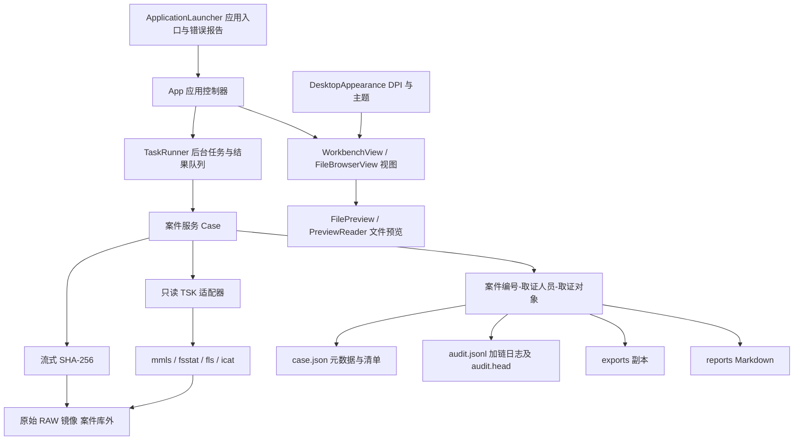

# TraceDesk 设计与验收说明

## 项目目标与技术路线

实现可复现的取证闭环：建立案件、只读加载、证据固定、文件分析、导出副本、审计及报告。根据课程建议以目录与 JSON 隔离案件，以 Python subprocess 调用 TSK 的命令行组件，避免 C/Python 二进制扩展安装问题。Tkinter 提供本地中文界面，业务层独立于界面，可直接自动化测试。

此文为工程说明与验收材料，不替代学生本人填写期末报告、学习心得和录制演示视频。用户提供的两份原始 Word 文档保持原样。

## 架构及数据流

GUI 将耗时任务放到后台线程，以队列将结果交回 Tk 主线程。执行期间禁止切换案件和关闭应用，防止任务写入错误案件。目录名由案件编号、取证人员和取证对象组成。路径分隔符等禁用字符替换为下划线，重名时添加序号；案件元数据保留独立 UUID。

2026-11-10 界面重构保留 `Case`、`TSK` 和案件文件格式，将布局、主题、对话框、文件树批次显示、任务队列与操作协调拆成独立类。主线程消费 `TaskResult` 后更新控件，工作线程不调用 Tk。启动方式沿用原有 BAT 脚本：切换到项目目录，首次创建 `.venv`，通过 `.venv\Scripts\python.exe main.py` 启动；保留终端窗口，运行失败时暂停。应用入口和界面回调异常写入日志并弹窗显示。高 DPI 感知在创建 Tk 之前设置，字体按点数渲染，显式控件尺寸随 DPI 缩放。

## 需求对应与验收方法

| 评分功能 | 实现位置 | 验收依据 |
| --- | --- | --- |
| 新建/打开案件与元数据 | Case.create、Case.__init__ | 重开后保留导出记录；相同编号隔离 |
| RAW 加载、分区和文件系统 | Case.load、TSK.inspect、Case.scan | 真实 mmls 分区偏移 2048；fsstat；偏移 0 卷测试 |
| SHA-256 固定与校验 | sha256、Case.verify | 与独立 hashlib 结果一致；篡改后校验失败 |
| 文件树、大小、MAC、后缀 | TSK.files、GUI.display、Case.filtered | 递归 DOCS/CASE.TXT；TXT 与关键词过滤 |
| 关键操作审计 | Case.log、Case.check_audit | 显示东八区（UTC+8）时间、主体、对象、结果；修改/截断检测 |
| 现存与已删除文件导出 | Case.export、TSK.export | 5 个文件逐一与独立夹具哈希及长度比较；目录拒绝导出 |
| Markdown 报告 | Case.report | 案件、原证据哈希、日志摘要、文件摘要、结论、确认栏；无 HTML 报告 |

## 关键模块

`case.json` 保存案件编号、人员、对象、创建时间、原始证据路径/哈希/大小/固定时间/分区、当前分区清单、导出清单及最近校验结果。`exports` 仅存副本；`reports` 仅存 Markdown。原始镜像不复制进案件库。案件库与镜像分属目录，跨物理介质仍需部署操作保证。

TSK 调用以参数数组执行且不启用 shell；工具名仅限读取白名单。mmls 提取分区起始扇区；无分区表时由 fsstat 确认偏移 0 文件系统。fls 分别使用 `-u` 和 `-d` 递归读取现存和已删除目录项，保留每条记录的路径、inode、类型、长度、时间和分配状态。文件树保留 TSK 虚拟条目。FAT 空间视图按分配表和现存目录项引用的簇链计算。MAC 分别是修改、访问、元数据变更，B 为创建。无时区文件系统按 UTC 解释，界面按东八区显示。

哈希每次读取 1 MiB，内存占用不随镜像大小增长；对已打开文件比对读取前后身份、长度、修改时间。导出前后重新计算完整镜像哈希；现存文件要求导出大小与目录记录一致。已删除文件沿用预览的读取方式，保存最多至目录记录大小的可读字节，并记录实际长度、簇占用或 inode 重分配信息及副本哈希。非空记录未能读出任何字节时，导出失败。哈希一致只能证明本次读取内容一致，无法替代写阻断或防范恶意并发替换路径。

审计记录字段：seq、timestamp、actor、action、subject、result、details、previous、hash。hash 是除自身外的规范化 JSON 与前序摘要的 SHA-256。追加并 fsync 后写入 audit.head。重开案件或继续追加前验证整链与尾部锚点；程序不提供编辑/删除日志入口。双文件更新在断电时可能不一致，此时失败关闭，需要保留现场另案检查，不能直接“修复”原日志。

报告生成时重新读盘校验；不匹配时明确写“不通过”，不伪造成功结论。报告记录当前文件清单最多 200 项、最近 100 条审计和全部导出记录，完整清单与日志仍在案件文件。报告包括生成开始事件，报告成功事件在文件写成后追加至原日志；报告内锚点对应生成时快照。

## 合规设计与边界

本项目根据课程文档提出的只读、完整性、可审计原则实现，不作 SF/T 0146-2023 全条款符合性声明或认证声明。未取得标准全文逐条评审，也未引入硬件写保护或可信签名服务。目录分离、追加接口、哈希链是应用层控制；有本地写权限者仍能改动 JSON 和原镜像。Windows 使用文件锁限制同一案件同时打开，切换案件或退出时释放。

## 系统测试

执行环境：Windows，Python 3.13，Tk 8.6，官方 The Sleuth Kit 4.15.0 Windows。用纯 Python 构建 9 MiB（带分区表）和 8 MiB（卷）FAT16 镜像，包含根目录、子目录、UTF-8 文本、CSV 和跨簇二进制文件。文件内容由生成器独立给出预期哈希，不以被测导出结果反推预期。

`docs/test-results.txt` 保存实际测试输出。测试包括完整真实 TSK 主链路、偏移 0 卷、筛选、镜像篡改后导出阻断与失败报告、日志修改检测、日志截断检测、同编号案件隔离与镜像位置约束、坏镜像失败审计、目录导出拒绝、跨缓冲区哈希。未进行大容量/坏扇区/加密文件系统/NTFS 多属性/并发进程测试，不能将课程测试结果外推到这些场景。

开发环境中的沙箱会导致官方 TSK 出现 WinError 623，已在获准的正常 Windows 进程环境执行真实测试；测试文件仍只写入本项目。该现象与镜像解析逻辑无关。

## 个性化功能与改进空间

审计哈希链增加对篡改的可见性；MAC/B 时间线帮助定位文件活动；导出副本哈希和前后校验把文件导出纳入证据链。后续可增加外部签名/可信时间戳、流式清单索引、任务取消、更多文件系统夹具及独立物理介质检测。

AI 参与范围见根目录 THIRD_PARTY_NOTICES.md。学生需要亲自读懂关键代码，补充真实操作截图、独立心得、姓名学号，并录制 3–5 分钟流程；这些学习材料未被虚构或代签。
